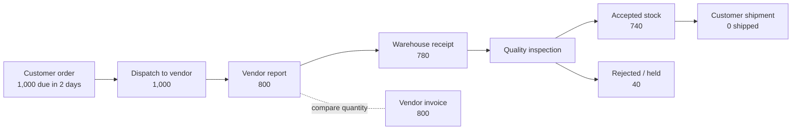

# ForgeFlow ERP

**A focused, clickable prototype for the subcontracting exception in the Full Stack Developer assignment.** It helps a production manager see what was sent to a heat-treatment vendor, what the vendor reported, what physically returned, what passed inspection, and what remains at risk for customer delivery.

**Live demo:** [Open ForgeFlow ERP](https://forgeflow-erp-theta.vercel.app/dashboard)

## The assignment scenario

| Checkpoint | Quantity | What it means |
|---|---:|---|
| Customer demand | 1,000 | Finished components due in two days |
| Opening finished stock | 0 | No stock is available to cover a shortfall |
| Sent to subcontractor | 1,000 | All required components were dispatched for heat treatment |
| Vendor reported returned | 800 | Vendor update; this is not proof of warehouse receipt |
| Physically received | 780 | Count recorded by the warehouse |
| Quality accepted | 740 | Only these units are available to ship |
| Rejected / held | 40 | Held for possible rework; not included in available stock |
| Vendor invoice quantity | 800 | Invoice quantity is compared with report, receipt, and accepted stock |
| Shipped to customer | 0 | The delivery shortfall and due date remain visible |

The prototype preserves these differences. It never changes one checkpoint's quantity to make it agree with another.



## Run the prototype

Requires **Node.js 24.x** and **pnpm 12.15.0**.

```sh
pnpm install
pnpm dev
```

Open the local URL shown in the terminal. No credentials, environment variables, paid services, or external accounts are required. The seeded assignment scenario loads automatically. Use **History → Reset demo data** to restore it after exploring.

## Suggested three-minute walkthrough

**Walkthrough recording:** [Watch the ForgeFlow ERP demo](https://drive.google.com/file/d/1bNisS7o0y7lE5OEZlYxQe5LIh-slRZJ5/view?usp=drive_link)

| Time | Show |
|---|---|
| 0:00–0:30 | Dashboard: 1,000 units due, 740 accepted and available, zero shipped, and the delivery shortfall. |
| 0:30–1:10 | Order detail: vendor report, physical receipt, inspection, invoice, and shipment are separate checkpoints. |
| 1:10–1:40 | Warehouse and Quality: partial receipt; accepted plus rejected equals the receipt; held units cannot ship. |
| 1:40–2:10 | Reconciliation: compare reported with received/invoiced quantities and resolve with an auditable note. |
| 2:10–2:35 | Imports: duplicate detection, simulated outage, and retry of a failed vendor update. |
| 2:35–3:00 | Integration plan: explain why the customer's ERP stays authoritative and why idempotency, exception review, and fallback are built into the rollout plan. |

The History screen also shows the local audit trail and backup controls.

The import outage is simulated in the browser. It does not contact a vendor or external service.

## Workflow and safeguards

- Dispatch, vendor report, warehouse receipt, inspection, invoice, and shipment are separate records.
- Dispatch, receipt, invoice, and shipment references are generated automatically. A supplier's invoice number can be recorded separately.
- Dispatch and receipt quantities must be positive whole units and cannot exceed the remaining physical balance.
- Inspection accounts for every unit on a receipt exactly once. Accepted and rejected quantities must sum to the receipt quantity.
- Customer shipment can use accepted, unshipped stock only. Rejected and uninspected units are excluded.
- Invoice or vendor-reported differences remain visible for review; they do not silently change inventory.
- Vendor-update CSV imports validate order/vendor references, skip repeated external IDs, preserve failed rows, and support retry.
- Important changes appear in local activity history. Backup restore validates the data before replacing the current browser workspace.

## Research and design decisions

The assignment asks for research into two manufacturing ERP products. The solution uses the following documented process ideas:

- [SAP S/4HANA subcontracting](https://help.sap.com/docs/SAP_S4HANA_ON-PREMISE/fe39e10a9a864a8f8dc9537704f0fa13/4f13b953495bb44ce10000000a174cb4) informed treating subcontracting as an explicit material movement.
- [Odoo subcontracting](https://www.odoo.com/documentation/18.0/applications/inventory_and_mrp/manufacturing/subcontracting.html) informed keeping vendor execution visible against the production order.
- [Odoo quality checks](https://www.odoo.com/documentation/18.0/applications/inventory_and_mrp/quality/quality_management/quality_checks.html) informed separating physical receipt from inspection and accepted stock.

For this exception workflow, the key design choice is to show each source's quantity side by side. A vendor statement is not treated as a goods receipt, and a goods receipt is not treated as quality acceptance.

## Screens

| Screen | Purpose |
|---|---|
| Dashboard | Order progress, quantity KPIs, exceptions, and delivery risk |
| Orders | Create and track production orders and their subcontracting workflow |
| Vendors | Maintain subcontractor records and see assigned work |
| Warehouse receipts | Record partial physical returns against dispatched quantities |
| Quality | Classify each receipt into accepted and rejected / held units |
| Reconciliation | Compare vendor statements with dispatch, receipt, quality, and invoice records |
| Imports | Simulate duplicate-safe vendor updates, outage, and retry |
| History | Review activity, paginate/search events, and export or restore local backups |

## Verify the project

```sh
pnpm typecheck
pnpm lint
pnpm test
pnpm build
```

`pnpm verify` runs all four checks. Workflow tests cover the seeded scenario, quantity boundaries, duplicate references and imports, retry behavior, backup validation, and report snapshots.

## Integration plan and deployment

- [INTEGRATION_PLAN.md](./INTEGRATION_PLAN.md) maps likely integrations, implementation paths, failure handling, and a phased delivery plan.
- [VERCEL_DEPLOYMENT.md](./VERCEL_DEPLOYMENT.md) explains how to deploy the review demo.

## Assumptions, limitations, and unfinished work

- The assignment gives invoice quantity, but no prices, currency, tax, payment terms, or accounting treatment. The prototype records quantity and references only; it does not calculate a payable amount or approve an invoice.
- The 40 rejected units are held for possible rework. A full rework, reinspection, scrap authorization, and vendor debit / credit lifecycle is not implemented.
- “No other finished stock” is treated as zero opening stock for this customer order.
- Data is stored in each browser's local storage. There is no server database, login, shared workspace, role authorization, real vendor/ERP integration, or durable backup service. This is a review demo, not a production system of record.
- A short walkthrough recording is linked above.

## Assignment submission notes

- **AI tool used:** OpenAI Codex. One correction made during review was to preserve vendor-reported, warehouse-received, and quality-accepted quantities independently instead of combining them into a single completed quantity.
- **Time spent (approximate):** Task 1 — about 3 hours; Task 2 — about 2 hours; approximately 5 hours total.
- **Unfinished:** Production persistence and authentication, live connectors, monetary invoice matching, and the complete rejected-part disposition loop are outside this prototype.
